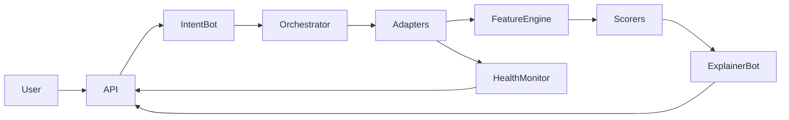

# TideWise

Water recreation recommendations for the **San Francisco Bay Area coast** (Half Moon Bay, Pacifica, SF Bay): clamming, crabbing, swimming, and sailing.

TideWise combines **live NASA/NOAA Earth-observation data** with tide, buoy, and weather feeds. It is not a chart on top of one API — it validates feeds, derives signals, applies hard safety gates, scores time windows, and explains the result in plain English (with confidence and degraded-source callouts).

> **Safety:** Planning aid only. Verify local closures, licenses, weather alerts, and official guidance before entering the water. **Missing safety data never counts as safe.**

Hackathon track: **Make space data useful.**

## Who it helps

Coastal recreators who need a trustworthy “where and when” answer that accounts for tides, marine weather, water quality, and satellite SST/chlorophyll — and who need to know when the answer is uncertain because a feed is down.

## Architecture



**Bot management system**

1. **IntentBot (Grok)** — user text → typed `QueryIntent` (or a clarifying question).
2. **Orchestrator** — activity config → concurrent adapters (timeouts) → pipeline.
3. **Source adapters** — shared interface: timeout, retry/backoff, TTL cache, sentinel validation, fallback chain, stale-on-failure.
4. **FeatureEngine** — hourly grid per spot (tide phase, slack/minus windows, daylight, moon, wind vs shoreline, waves, SST anomaly, bloom flag, alerts).
5. **ActivityScorers** — YAML gates + weights; hard gates first; 0–100 score; confidence from freshness.
6. **ExplainerBot (Grok)** — grounded plain-English recommendation (no invented numbers).
7. **HealthMonitor** — per-adapter status → `GET /health` + UI panel.

## Data sources

See [`DATA_SOURCES.md`](DATA_SOURCES.md) (research session). Adapters and probes are built from that document; if a live call disagrees, we trust the live call and note it here and in `DEVLOG.md`.

## Robustness

- Per-source TTL cache; serve **stale** with status flagged when live fetch fails.
- Validation rejects NDBC sentinels / impossible ranges.
- Fallback chains (nearest buoy → next → NWS grid → unknown).
- **Failure injection:** `POST /debug/fail/{source}` when `DEBUG=true`.
- App never crashes on a feed failure — degrades and says so.
- Structured fetch logging (source, status, latency, cache hit, fallback).

## Repo layout

```text
backend/          FastAPI, adapters, features, scorers, bots, orchestrator
frontend/         Vite + React + TypeScript + Tailwind
scripts/probes/   Live source probes (Phase 2)
tests/            pytest (fixtures for unit tests only; live path hits real APIs)
grok-sessions/    research / build / review exports
REVIEWS/          review-session findings
DATA_SOURCES.md   research session (do not edit in build)
DEVLOG.md         decisions, bugs, review triage
```

## Try it

Live API: `https://tidewise-api.onrender.com` (the free tier may take ~30 s to wake up).

```bash
# Ranked crabbing windows at Pillar Point (crabbing needs gear=, otherwise the gear gate is cannot_confirm)
curl "https://tidewise-api.onrender.com/recommend?activity=crabbing&spot=pillar_point_harbor&gear=hoop_net"

# Plain-English question
curl -X POST https://tidewise-api.onrender.com/query \
  -H 'content-type: application/json' \
  -d '{"text":"crabbing at Pillar Point with a hoop net"}'

# Clamming with an explicit window (timezone-aware start/end required). Scoring only covers the
# next ~48-72 h of forecast inputs, so a far-future range like Dec 5 currently returns no windows.
curl "https://tidewise-api.onrender.com/recommend?activity=clamming&spot=pillar_point_harbor&start=2026-12-05T10:00:00-08:00&end=2026-12-05T18:00:00-08:00"
```

Windows show `eligible: false` with `cannot_confirm` gates whenever a safety source (CDPH shellfish advisories, satellite chlorophyll) is down or stale. That is intentional: missing data never passes a safety gate. Swimming and sailing currently stay cannot_confirm (bacteria and NWS alerts are not yet fed into scoring).

## How to run locally

```bash
cp .env.example .env
# set XAI_API_KEY when you reach IntentBot/ExplainerBot

make install
make dev          # API http://localhost:8000
make frontend     # UI  http://localhost:5173
make test
```

API surface (live at https://tidewise-api.onrender.com; free Render, about 50 s cold start):

- `POST /query` `{ "text": "..." }`
- `GET /recommend?activity=&spot=&start=&end=`
- `GET /health`
- `GET /spots`
- `POST /debug/fail/{source}` / `POST /debug/reset` (DEBUG only)

## How Grok Bot was used

| Session | Role | Exports |
| --- | --- | --- |
| Research | Endpoints, station IDs, quirks, thresholds, spot list → `DATA_SOURCES.md` | `grok-sessions/research/` |
| Build | Plan, implement, debug (this track) | `grok-sessions/build/` |
| Review | Phase reviews → `REVIEWS/` | `grok-sessions/review/` |

## Demo script / video / slides

- **App:** https://tidewise-asunny.vercel.app
- **API:** https://tidewise-api.onrender.com (free Render, about 50 s cold start)
- **Slides:** https://docs.google.com/presentation/d/1dUlozPYD897xqW1JyfsQNxPoVqmrxNKCozvRVlQtWTc/edit

## Built today vs. next

**Built today**
- FastAPI backend and Vite/React frontend, deployed; live feeds with `/health` and `/spots`.
- Hard safety checks (shellfish biotoxin closures, beach bacteria limits, NWS marine alerts) override the score.
- UNKNOWN only when a live safety feed fails; dated snapshots and stale-marked cache fallback.
- Bad-buoy-reading rejection and tests.

**Next**
- Scored time windows: as of 4:19 PM PT, `/recommend` for clamming at `pillar_point_harbor` returns `windows: []` and `best_score: null`.
- Plain-English `/query`: IntentBot and ExplainerBot are not built yet.

## Built with Grok Bot and Cursor

**Bots**
- Grok Bot: API picks and data layer. Specific: per-activity research.
- Henry Reader: `DATA_SOURCES.md` live API verification and push.
- API changer presentation with Grok Bot: deck edits. extra task: audit and coordination.
- Cursor cloud agent: repo commits.

**Features:** multiple bots handing work to each other, a shared computer, skills, memory, connectors (Google Slides, GitHub), a Cursor cloud agent, and approvals.

## Deployment

Live URLs (verified 2026-11-19):

- Frontend (Vercel): https://tidewise-asunny.vercel.app
- Backend API (Render): https://tidewise-api.onrender.com — try [`/health`](https://tidewise-api.onrender.com/health) and [`/spots`](https://tidewise-api.onrender.com/spots)

Both redeploy automatically on every push to `main`.

The backend runs on Render's free plan, which sleeps after about 15 minutes idle; the first request after that can take ~50 seconds.

### Backend (Render)

Configured by `render.yaml` (Blueprint) or manually as a Python web service:

- Root directory: repository root
- Build command: `pip install -r requirements.txt`
- Start command: `uvicorn backend.api:app --host 0.0.0.0 --port $PORT`
- Health check path: `/health`
- Environment: `PYTHON_VERSION=3.11.9`, `APP_ENV=production`, `DEBUG=false`, `NWS_USER_AGENT=TideWise/0.1 (https://github.com/AarenSunny/tidewise-grokathon)`; optional secret `XAI_API_KEY` (set in the Render dashboard, never committed)
- `CORS_ORIGINS` (comma-separated exact origins, no wildcards; see `backend/settings.py`) must list every deployed frontend origin, or browsers will block API calls. Currently set on Render to `https://tidewise-asunny.vercel.app,https://tidewise-two.vercel.app,https://tidewise-git-main-asunny.vercel.app,https://tidewise-git-deploy-api-check-readme-asunny.vercel.app,http://localhost:5173,http://127.0.0.1:5173`. Vercel preview URLs for other branches are blocked unless added.

### Frontend (Vercel)

- Root directory: `frontend`
- Framework preset: Vite (see `frontend/vercel.json`)
- Build command: `npm run build`
- Output directory: `dist`
- Environment: `VITE_API_URL=https://tidewise-api.onrender.com`

Vite embeds `VITE_API_URL` at build time, so redeploy the frontend after changing it. The frontend builds API URLs from `API_BASE_URL` in `frontend/src/lib/api.ts` (reads `VITE_API_URL` or `VITE_API_BASE_URL`); leave `VITE_API_URL` unset locally to use the Vite dev proxy to `localhost:8000`.
